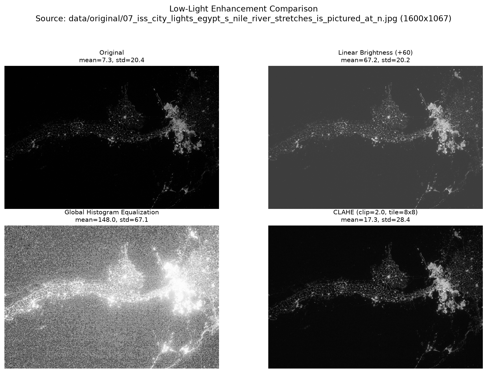
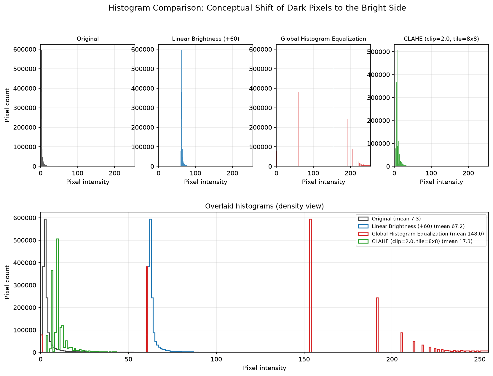

# Classical Low-Light Image Enhancement

A comparative study of three **classical, non-learning** low-light image enhancement
techniques implemented with OpenCV and NumPy, evaluated on real night-time imagery.

No deep learning, no pretrained models, no AI APIs — every result below comes from
pixel arithmetic, histogram mapping, or local histogram equalisation.

| Method | Operation | One-line idea |
|---|---|---|
| Linear Brightness | `cv2.add(gray, 60)` | Shift every pixel up by a constant |
| Global Histogram Equalization | `cv2.equalizeHist()` | Stretch the global histogram over 0–255 |
| CLAHE | `cv2.createCLAHE(2.0, (8, 8))` | Equalise locally, under a contrast limit |

---

## Results at a glance

Run on `data/original/07_iss_city_lights_egypt_s_nile_river_stretches_is_pictured_at_n.jpg`
(1600×1067, the darkest image in the dataset):

| Method | Mean | Std dev (contrast) | vs. original | Min | Max | Pixels clipped |
|---|---:|---:|---:|---:|---:|---:|
| Original | 7.25 | 20.36 | — | 0 | 255 | 4.56 % |
| Linear Brightness (+60) | 67.24 | 20.19 | −0.8 % | 60 | 255 | 0.10 % |
| Global Histogram Equalization | 147.99 | 67.10 | **+229.6 %** | 0 | 255 | 4.75 % |
| CLAHE (clip=2.0, tile=8×8) | 17.31 | 28.44 | +39.7 % | 1 | 255 | 0.00 % |

**Reading the numbers.** Standard deviation of pixel intensities is used as the
contrast metric.

- **Linear brightness** raises the mean from 7 to 67 but leaves the spread almost
  untouched (−0.8 %). Adding a constant translates the histogram; it does not widen
  it. The image looks brighter, not more detailed, and 0.10 % of pixels saturate at 255.
- **Global equalisation** produces by far the largest standard deviation, but most of
  that gain is amplified sensor noise in the flat sky region — the histogram is spread
  across the full range regardless of whether the content there is signal or noise.
- **CLAHE** improves contrast by a moderate, controlled amount (+39.7 %) while keeping
  the mean low and clipping nothing, because the CDF slope is capped per tile.

The "clipped" column counts pixels pinned at 0 or 255. The original image's 4.56 %
is pre-existing clipping in the source data, not something the pipeline introduced.

### Visual comparison



### Histogram comparison

The top row shows one histogram per method; the bottom panel overlays all four, making
the conceptual shift visible — the original's mass sits at intensity ≈ 0, linear
brightness translates it to ≈ 60, global equalisation smears it across the entire
range, and CLAHE widens the occupied band while staying dark.



---

## How it works

Everything lives in one script, `src/lowlight_enhancement.py`, with four stages.

### 1. Load and preprocess

The image is decoded straight to single-channel 8-bit grayscale with
`cv2.imread(path, cv2.IMREAD_GRAYSCALE)` — grayscale is required by the assignment and
makes all three methods operate on the same 0–255 domain.

With no argument, the script scans `data/original/`, reads each candidate's mean
luminance, and picks the **darkest** image, so the default demo is always the hardest
case. An explicit path overrides this.

If the folder contains no readable image, a synthetic underexposed image is generated
from NumPy (seeded, so it is reproducible) and written to
`data/original/synthetic_dark.png`. It has a faint gradient background (20–45), four
Gaussian light blobs, low-frequency structure, and mild Gaussian noise — enough detail
for the contrast-limited method to show a difference.

### 2. The three enhancement methods

**Method 1 — Linear brightness** (`linear_brightness`)

```python
enhanced = cv2.add(gray, 60)
```

A constant `BETA = 60` is added to every pixel. `cv2.add` **saturates** at 255 rather
than wrapping around like a plain `uint8` NumPy addition (`gray + 60` would wrap bright
pixels to near-black). Clipping is therefore possible and is measured and reported:
pixels already above 195 become 255 and their detail is lost. 60 was chosen because
the dataset's images have a mean luminance of roughly 7–27, so it lifts the shadows
into a visible range without saturating most of the frame.

**Method 2 — Global histogram equalization** (`global_histogram_equalization`)

```python
enhanced = cv2.equalizeHist(gray)
```

Builds the image's cumulative distribution and remaps each intensity through it, so the
occupied histogram is spread over the full 0–255 range. It is *global*: a single mapping
is applied to every pixel, so a large flat dark region (sky, water) gets stretched just
as aggressively as a detailed region, amplifying its noise.

**Method 3 — CLAHE** (`clahe`)

```python
enhanced = cv2.createCLAHE(clipLimit=2.0, tileGridSize=(8, 8)).apply(gray)
```

Contrast Limited Adaptive Histogram Equalization divides the image into an 8×8 grid of
tiles and equalises each tile independently, which adapts to local content. The
`clipLimit` caps how much any single histogram bin may contribute, limiting the CDF
slope and therefore limiting noise amplification. OpenCV blends tile boundaries
bilinearly so no visible seams appear.

### 3. Metrics

`contrast_stats()` computes, for all four images:

| Statistic | Why it matters |
|---|---|
| Mean | Whether the image was actually brightened |
| Standard deviation | The contrast metric required by the project |
| Min / Max | Whether the full dynamic range is being used |
| Clipped pixels (%) | Information destroyed by saturation |

`print_metrics()` prints a table and adds the percentage change in standard deviation
relative to the original.

### 4. Figures

- `plot_comparison()` — a 2×2 grid: Original, Linear Brightness, Global Hist Eq, CLAHE.
  Each panel is titled with its method and its mean/std, using `vmin=0, vmax=255` so the
  four images are directly comparable rather than auto-normalised.
- `plot_histograms()` — one histogram per method, plus a full-width overlaid panel.

Both are saved to `analysis/figures/` and then shown interactively when a GUI backend
is available.

---

## How to run it for any image

### Requirements

- Python 3.10+
- `opencv-python`, `numpy`, `matplotlib`

```bash
pip install opencv-python numpy matplotlib
```

### Quick start

From the project root:

```bash
python3 src/lowlight_enhancement.py
```

This analyses the darkest image in `data/original/` and writes both figures.

### Any image you want

Pass the image path as the **first and only positional argument**:

```bash
python3 src/lowlight_enhancement.py /path/to/your/image.jpg
```

The file does **not** have to be inside this project, and it does not need to be a
night photo — the three methods run on any grayscale-convertible image:

```bash
python3 src/lowlight_enhancement.py ~/Pictures/sunset.png
python3 src/lowlight_enhancement.py "data/original/15_dark_landscape_the_aurora_borealis_adds_green_hue_to_night_s.jpg"
```

### Paths with spaces or special characters

Quote the argument — otherwise the shell splits it into several arguments:

```bash
python3 src/lowlight_enhancement.py "/home/me/My Photos/night shot.jpg"
```

`~` is expanded automatically. Tips:

- Drag the file from your file manager onto the terminal instead of typing the path.
- Tab completion works — type a few characters and press <kbd>Tab</kbd>.
- Relative paths resolve from your current shell directory, so either `cd` into the
  project first (as above) or use an absolute path.

### Running from any directory

Use the absolute path to the script:

```bash
python3 "/home/muhibali/Documents/Default Project/Portfolio Projects by Muhib Ali/Image-Enhancement/src/lowlight_enhancement.py" ~/Pictures/night.jpg
```

The script always writes its figures into the project's `analysis/figures/`, regardless
of where you run it from.

### Headless machines / SSH / no display

On a server or over SSH there is no window to show plots in. Force the non-interactive
Agg backend so the script only writes PNG files:

```bash
MPLBACKEND=Agg python3 src/lowlight_enhancement.py ~/Pictures/night.jpg
```

(Windows PowerShell: `$env:MPLBACKEND="Agg"; python src\lowlight_enhancement.py image.jpg`)

### Supported formats

`.jpg` `.jpeg` `.png` `.bmp` `.tif` `.tiff` — anything OpenCV can decode. One image per
run; run it again with a different path to compare another image.

### What you get

Console output:

```text
Loaded data/original/07_iss_city_lights_egypt_s_nile_river_stretches_is_pictured_at_n.jpg (1600x1067, mean=7.3)

Method                                          Mean   Std Dev   vs Orig   Min   Max  Clip %
--------------------------------------------------------------------------------------------
Original                                        7.25     20.36    (base)     0   255    4.56
...
Saved visual comparison  -> analysis/figures/07_..._comparison.png
Saved histogram comparison -> analysis/figures/07_..._histograms.png
```

Files, named after the input image's filename stem:

- `analysis/figures/<image_name>_comparison.png`
- `analysis/figures/<image_name>_histograms.png`

---

## Dataset

`data/original/` holds 17 low-light images (NASA / ISS night-time Earth observation and
aurora landscapes). 16 of them are documented in `dataset_sources.csv`, which records
the Wikimedia Commons file page, author, licence, licence URL, and the measured
brightness statistics for each.

All documented images are **public domain or CC0**, so they can be redistributed with
this project. Provenance is kept in the CSV for attribution.

`dataset_sources.csv` was produced by `src/fetch_dataset.py`, which searches Wikimedia
Commons for openly licensed night imagery, downloads 1920 px-wide copies, measures
brightness, and keeps the darkest candidates that still contain real structure
(mean ≤ 95, std ≥ 18, 99th percentile ≥ 90). Re-running it is optional and requires
network access; the images are already in the repository.

---

## Project structure

```text
.
├── src/
│   ├── lowlight_enhancement.py   # main analysis script — enhancement, metrics, figures
│   └── fetch_dataset.py          # dataset acquisition from Wikimedia Commons
├── data/
│   └── original/                 # 17 low-light input images
├── analysis/
│   └── figures/                  # generated comparison + histogram PNGs
├── results/                      # scratch space for metric exports
└── dataset_sources.csv           # per-image provenance and labels
```

---

## Notes and limitations

- **Grayscale only.** Colour processing (e.g. CLAHE on the L channel of LAB) is out of
  scope; the assignment requires grayscale input.
- **Fixed parameters.** `BETA = 60` and `clipLimit = 2.0` are hard-coded defaults tuned
  for this dark dataset. Bright inputs will saturate under +60; edit the constants at
  the top of the script to adapt them.
- **No quantitative ground truth.** The metrics measure contrast and clipping, not
  perceptual quality; no reference "well-exposed" image exists for these scenes.
- **Global equalization is included as a baseline, not a recommendation** — its standard
  deviation gain is largely noise amplification.
